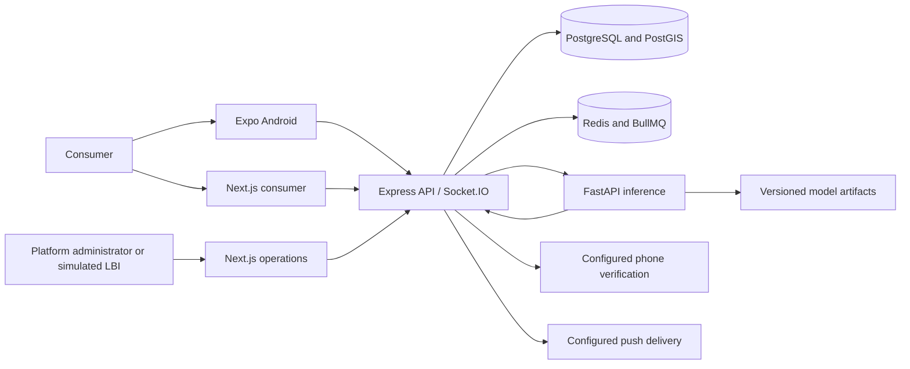
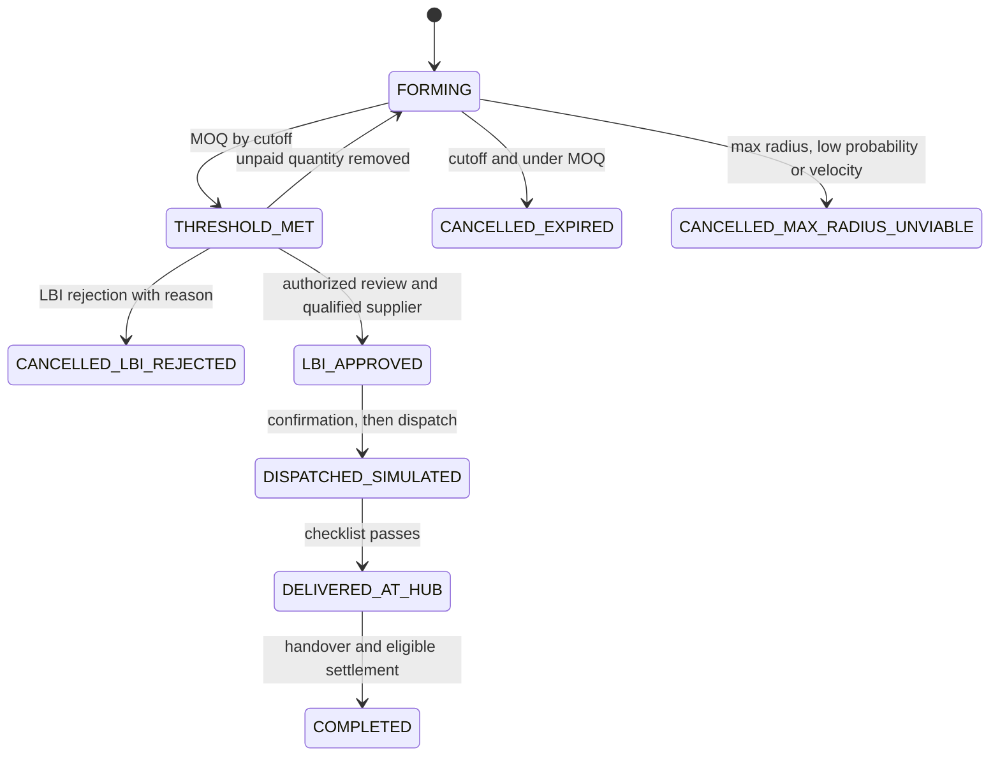

# Byoo architecture

Byoo combines nearby demand for a single essential product. The consumer Android and web surfaces share contracts, while operations run in a separately authorized administration application. Every monetary and fulfillment action is an academic simulation.

## Decision records

1. **One transactional authority.** The Express service owns state, geospatial eligibility, authorization, supplier allocation, cutoff times and the simulated ledger. FastAPI estimates viability and proposes a radius. The API validates fresh locked state before taking action.
2. **PostGIS geography.** Use the WGS-84 SRID 4326 geography type, a GiST index and spheroidal distance across approved Islamabad sectors. Consumers can select a sector when device location is unavailable.
3. **Exact money.** All wire values use PKR minor units. The 3% margin rounds to the nearest paisa with half ties rounded up. The supplier receives the wholesale residual. This deterministic split preserves the four-account invariant.
4. **Same-origin browser API.** Browser applications forward JSON requests from their own origin to the API. Session cookies are HttpOnly. Android explicitly obtains mobile tokens and keeps them in secure storage.
5. **Partner simulation.** Checkout methods identify the user-selected simulator only. Dispatch, hub inspection and settlement are internal records. This preserves the approved FYP boundary.
6. **Operational isolation.** Redis retries and transient broadcast complement persistent database activity records. Some notifications may be observed after reconnect and refetch. The model service cannot authorize any transaction.

## Persistence and failure handling

The schema and versioned Prisma SQL migrations are under `apps/api/prisma`. Financial mutations use explicit transactions, row locks and idempotency. Critical state changes and their audit records must commit together. Notification handlers can retry independently of a committed order or ledger entry.

For local development Docker Compose provisions PostgreSQL/PostGIS and Redis. The API, inference service, and surfaces run as workspace processes. Hosting targets are Vercel for the browser surfaces, Render for the two services, Neon for PostgreSQL with PostGIS, and Upstash for Redis. Future distributed infrastructure and commercial integrations are beyond the FYP boundary.
